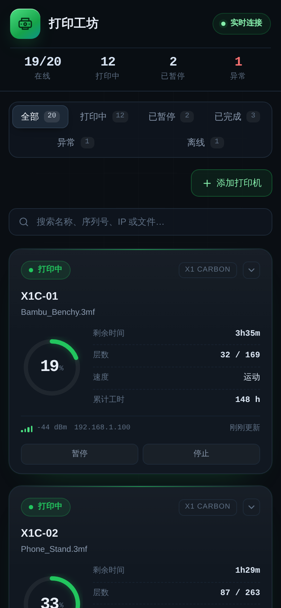

# 打印工坊 · 拓竹打印机监控

一个面向 **20 台（可更多）拓竹 / Bambu Lab 打印机** 的局域网实时监控面板。

后端直接用 MQTT over TLS 连接每台打印机，读取官方 App 同源的 `push_status` 数据；前端通过 SSE 接收推送，无需刷新页面。

> 收到安装包只想快速上手？直接看 **[INSTALL.md](INSTALL.md)**（详细安装教程）。


桌面端与移动端自适应：



## 功能

- **多机总览**：在线数、打印中、暂停、异常数量一眼可见
- **网页管理**：一键扫描局域网打印机，自动识别型号 / 序列号 / IP；支持网页添加、删除设备，无需改配置文件
- **打印进度**：进度环、剩余时间、当前层 / 总层数、速度档位
- **风扇转速**：部件风扇、热端风扇、辅助风扇、腔体风扇（含转速条）
- **温度**：喷嘴、热床、腔体（实时值 / 目标值）
- **状态识别**：打印中、准备中、已暂停、已完成、失败、待机、离线
- **实时推送**：SSE 长连接，打印状态变化约 1 秒内更新；断线自动重连
- **筛选搜索**：按状态筛选，按名称 / 序列号 / IP / 文件名搜索
- **IP 展示**：每张卡片底部显示该台打印机的内网 IP
- **累计工时**：每台机器的累计工作时间，本地持久化，可叠加打印机屏幕上的历史值
- **异常提示**：打印失败或 `print_error` 非 0 时卡片高亮
- **可选控制**：暂停 / 继续 / 停止（默认关闭，需显式开启）
- **模拟模式**：无需打印机即可预览 20 台设备的完整界面
- **零前端依赖**：原生 HTML / CSS / JS，不依赖 CDN，适合内网离线运行

## 快速预览

```bash
python3 -m pip install -r requirements.txt
python3 server.py --mock
```

打开 `http://<运行机器的IP>:8088`，会看到 20 台模拟打印机，数据实时变化。

> 建议使用虚拟环境：
>
> ```bash
> python3 -m venv .venv
> . .venv/bin/activate
> pip install -r requirements.txt
> ```

要求 **Python 3.10+**、`paho-mqtt 2.x`。

> 如果创建虚拟环境时报 `ensurepip is not available`，先安装 `python3-venv`（Debian/Ubuntu：`sudo apt install python3-venv`）。

## 连接真实打印机

### 1. 打印机准备

1. 打印机与运行服务的电脑处于**同一局域网**。
2. 记下打印机的：
   - **IP 地址**（建议在路由器里为每台机器固定 DHCP）
   - **序列号（Serial）**
   - **访问码（Access Code，8 位）**，显示在网络设置页面

3. 根据你的需求选择模式：

| 打印机模式 | 查看状态 / 进度 / 风扇 | 暂停 / 继续 / 停止 | Bambu Handy 远程 |
| --- | --- | --- | --- |
| 云模式（正常模式） | 通常可以 | 当前固件会被拒绝 | 可用 |
| 局域网模式（LAN Only） | 可以 | 当前固件会被拒绝 | 不可用 |
| 局域网 + 开发者模式 | 可以 | 可以 | 不可用 |

- **只做监控**：可以先不开启局域网模式，直接填入 IP / 序列号 / 访问码尝试本地 MQTT。当前固件下 MQTT 状态推送通常不受授权系统限制。
- **需要页面上的暂停 / 继续 / 停止**：必须开启 **局域网模式 + 开发者模式**。只开 LAN Only 还不够。
- 开发者模式只能在局域网模式下开启，开启后打印机不能连接 Bambu 云，Handy 远程打印和云端历史会不可用。

> 访问码不是 Bambu 账号密码。它只用于局域网 MQTT，每台打印机不同。

各型号菜单位置：

- **X1 / H2 / P2S**：设置 → LAN Only / 局域网模式
- **P1 系列**：设置 → WLAN → LAN Only Mode
- **A1 系列**：设置 → LAN Only Mode

### 2. 配置

```bash
cp config.example.json config.json
```

编辑 `config.json`，为 20 台机器各写一条：

```json
{
  "title": "打印工坊",
  "server": {
    "host": "0.0.0.0",
    "port": 8088,
    "allow_control": false,
    "allow_manage": true
  },
  "printers": [
    {
      "name": "X1C-01",
      "model": "X1 Carbon",
      "serial": "01S00A000000001",
      "ip": "192.168.1.101",
      "access_code": "12345678",
      "baseline_hours": 0
    },
    {
      "name": "P1S-01",
      "model": "P1S",
      "serial": "01P00A000000002",
      "ip": "192.168.1.102",
      "access_code": "87654321",
      "baseline_hours": 0
    }
  ]
}
```

| 字段 | 必填 | 说明 |
| --- | --- | --- |
| `name` | 否 | 卡片显示名称，默认取序列号后 6 位 |
| `model` | 否 | 显示在卡片右上角，如 `X1 Carbon` / `P1S` / `A1` |
| `serial` | 是 | 打印机序列号，用于订阅 MQTT 主题 |
| `ip` | 是 | 打印机局域网 IP |
| `access_code` | 是 | 打印机访问码 |
| `baseline_hours` | 否 | 起始累计工时（小时）。填打印机屏幕上已有的总打印时长，默认 `0` |
| `allow_control` | 否 | 是否启用暂停 / 继续 / 停止按钮，默认 `false` |
| `allow_manage` | 否 | 是否允许在网页上扫描、添加、移除打印机，默认 `true` |
| `host` / `port` | 否 | 面板监听地址和端口，默认 `0.0.0.0:8088` |

> **关于累计工时**：拓竹固件只在打印机屏幕上显示总打印时长，**不通过 MQTT 上报**。
> 面板会在本地按「准备中 / 打印中 / 已暂停」状态累计，并写入配置文件同目录的
> `usage.json`。把打印机屏幕上已有的数值填到 `baseline_hours`，即可得到接近真实
> 的终身工时；不填则从安装后的第一次打印开始累计。

### 3. 在网页中添加 / 扫描打印机

打开面板后，点击工具栏右侧的 **添加打印机**：

1. 点击 **扫描局域网**，页面会监听拓竹打印机的 SSDP 广播（约 10 秒），
   自动列出同网段打印机的型号、IP、序列号和信号强度。
2. 点击扫描结果即可自动填入型号、序列号、IP；访问码需要按打印机屏幕填写。
3. 也可以完全手动填写，点击 **添加** 后立即生效，无需重启服务。

添加 / 移除会直接改写 `config.json` 并热加载该设备。若不需要网页管理功能，
把 `server.allow_manage` 设为 `false`，按钮和接口都会关闭。

> 扫描依赖 UDP 组播（239.255.255.250:1990 / 2021）。如果服务器跑在 Docker
> 桥接网络里，通常收不到广播，请改用 `network_mode: host` 或手动添加。

### 4. 启动

```bash
python3 server.py
```

访问 `http://<服务器IP>:8088`。

日志里会显示每台打印机的 MQTT 连接情况。没有数据时先看这里。

> 防火墙需放行 **8088/TCP**（浏览器访问面板），服务器出站需能访问打印机的 **8883/TCP**。

## 工作原理

```text
打印机 1  ── MQTT/TLS 8883 ─┐
打印机 2  ── MQTT/TLS 8883 ─┤
...                         ├─→ server.py ── SSE/HTTP 8088 ─→ 浏览器
打印机 20 ── MQTT/TLS 8883 ─┘
```

- 每台打印机一个独立 MQTT 线程，用户名固定 `bblp`，密码为访问码
- 订阅 `device/<serial>/report`，连接后发送 `pushall` 获取完整状态
- 每 45 秒补充一次 `pushall`，保证空闲设备数据不过期
- 浏览器通过 `/api/events` 接收 SSE 快照和增量更新
- 不依赖数据库；只有累计工时写入 `usage.json`，重启后自动重新拉取状态并继续计时

### 风扇数值说明

拓竹 MQTT 的四个风扇字段使用 **0–15** 原始档位（`15` = 100%）：

| 页面名称 | MQTT 字段 |
| --- | --- |
| 部件风扇 | `cooling_fan_speed` |
| 热端风扇 | `heatbreak_fan_speed` |
| 辅助风扇 | `big_fan1_speed`（兼容 `aux_fan_speed`） |
| 腔体风扇 | `big_fan2_speed`（兼容 `chamber_fan_speed`） |

`/api/printers` 返回原始值，页面按 `raw / 15 × 100%` 显示；如果固件上报 0–100 或 0–255，也做了兼容换算。

## 远程控制（可选）

默认只读。需要暂停 / 继续 / 停止时，在 `config.json` 中设置：

```json
"server": { "allow_control": true }
```

重启后卡片上会出现操作按钮。控制指令仍走局域网 MQTT：

```http
POST /api/printers/<serial>/command
Content-Type: application/json

{ "action": "pause" }   // pause | resume | stop
```

> ⚠️ 页面本身**没有登录鉴权**。开启控制后，请只在可信内网使用，或放在带 Basic Auth 的反向代理 / VPN 后面，**不要直接暴露到公网**。

## 部署

### 一键安装（推荐）

下载发布包后解压，一条命令装好：

```bash
tar -xzf bambu-monitor-1.1.0.tar.gz
cd bambu-monitor-1.1.0
sudo ./install.sh
```

可选参数：

| 参数 | 说明 |
| --- | --- |
| `--port 9000` | 自定义网页端口（默认 8088） |
| `--prefix /srv/bambu` | 自定义安装目录（默认 `/opt/bambu-monitor`） |
| `--user pi` | 指定运行用户（默认自动创建 `bambu`） |
| `--no-start` | 只安装，不立即启动 |

脚本会自动完成：创建运行用户、复制程序、建虚拟环境、安装依赖（优先离线 wheel）、生成空白配置、写入 systemd 服务并设置开机自启。

安装后填入打印机信息并重启：

```bash
sudo nano /opt/bambu-monitor/config.json
sudo systemctl restart bambu-monitor
```

卸载：

```bash
sudo /opt/bambu-monitor/uninstall.sh           # 保留配置
sudo /opt/bambu-monitor/uninstall.sh --purge   # 连目录和用户一起删除
```

### 手动部署（不用安装脚本）

```bash
sudo useradd -r -s /usr/sbin/nologin bambu
sudo mkdir -p /opt/bambu-monitor
sudo cp -r server.py static tools requirements.txt config.json /opt/bambu-monitor/
cd /opt/bambu-monitor
sudo python3 -m venv .venv
sudo .venv/bin/pip install -r requirements.txt
sudo chown -R bambu:bambu /opt/bambu-monitor

sed -e 's|@PREFIX@|/opt/bambu-monitor|g' \
    -e 's|@USER@|bambu|g' \
    -e 's|@PORT@|8088|g' \
    deploy/bambu-monitor.service.in \
  | sudo tee /etc/systemd/system/bambu-monitor.service

sudo systemctl daemon-reload
sudo systemctl enable --now bambu-monitor
```

### 制作发布包

```bash
bash tools/make_release.sh
```

产物在 `拓竹监控/`：`bambu-monitor-<版本>.tar.gz` 和对应 `.sha256`。打包时会自动排除 `config.json`、真实打印机清单等敏感文件，只带空白模板。

### Docker

```bash
cp config.example.json config.json
mkdir -p data
# 编辑 config.json 后：
docker compose up -d --build
```

`docker-compose.yml` 默认使用 `network_mode: host`（局域网扫描需要 UDP 组播），并把本机 `config.json` **读写**挂载进容器，累计工时写到 `./data/usage.json`（通过 `BAMBU_USAGE_FILE` 指定）。若改回 bridge 网络，请打开 compose 里的 `ports` 映射，扫描功能可能不可用，此时可在网页手动添加打印机。

### 反向代理 / HTTPS

面板只提供 HTTP。若需要 HTTPS，可用 Nginx / Caddy 反代到 `127.0.0.1:8088`，并额外加登录认证。SSE 需要关闭代理缓冲：

```nginx
location / {
    proxy_pass http://127.0.0.1:8088;
    proxy_http_version 1.1;
    proxy_set_header Connection "";
    proxy_buffering off;
    proxy_read_timeout 3600s;
}
```

## API

| 方法 | 路径 | 说明 |
| --- | --- | --- |
| `GET` | `/api/printers` | 所有打印机当前状态（JSON） |
| `GET` | `/api/events` | SSE 实时事件流 |
| `GET` | `/api/config` | 面板标题、控制 / 管理开关、设备数量 |
| `GET` | `/healthz` | 健康检查 |
| `POST` | `/api/scan` | 扫描局域网内的拓竹打印机（约 10 秒） |
| `POST` | `/api/printers` | 添加打印机并写入 `config.json` |
| `DELETE` | `/api/printers/<serial>` | 从监控和 `config.json` 中移除打印机 |
| `POST` | `/api/printers/<serial>/command` | 发送控制指令（需开启控制） |

添加打印机的请求体：

```json
{
  "name": "X1C-01",
  "model": "X1 Carbon",
  "serial": "01S00A000000001",
  "ip": "192.168.1.101",
  "access_code": "12345678",
  "baseline_hours": 0
}
```

单台打印机的返回示例：

```json
{
  "id": "01S00A000000001",
  "name": "X1C-01",
  "model": "X1 Carbon",
  "online": true,
  "status": "RUNNING",
  "status_label": "打印中",
  "progress": 42,
  "remaining_min": 87,
  "layer": 84,
  "total_layers": 200,
  "file": "Bambu_Benchy.3mf",
  "temps": {
    "nozzle": 219.4, "nozzle_target": 220,
    "bed": 59.2, "bed_target": 60,
    "chamber": 34.2
  },
  "fans": { "cooling": 15, "heatbreak": 15, "aux": 8, "chamber": 4 },
  "wifi": -48,
  "error": 0,
  "speed_level": 2,
  "speed_label": "标准",
  "last_seen": 0
}
```

## 项目结构

```text
.
├── server.py                      # MQTT 采集 + HTTP/SSE 服务
├── static/
│   ├── index.html                 # 页面结构
│   ├── style.css                  # 深色仪表盘样式
│   └── app.js                     # SSE、渲染、筛选、扫描/添加
├── tools/
│   ├── check_printer.py           # 单台访问码验证
│   ├── build_config.py            # 从 CSV 批量生成 config.json
│   └── make_release.sh            # 生成 dist/ 安装包
├── deploy/bambu-monitor.service.in # systemd 服务模板
├── docs/                          # 界面截图
├── install.sh / uninstall.sh      # 一键安装 / 卸载
├── config.example.json            # 配置模板
├── README.md / INSTALL.md         # 项目说明 / 详细安装教程
├── requirements.txt
├── Dockerfile
└── docker-compose.yml
```

## 常见问题

### 全部显示“离线”

1. `ping <打印机IP>` 是否通
2. 服务器是否和打印机在**同一网段**（跨路由器 NAT 需要额外打通）
3. 访问码是否填对（每台机器不同，区分大小写）
4. 服务器到打印机的 **8883/TCP** 是否被防火墙拦截
5. 看服务日志里的具体报错

> 本程序通过局域网 MQTT 直连打印机，需要打印机开启**局域网模式（LAN Only）**并在屏幕网络设置中查看访问码。

### 日志显示“MQTT 连接被拒绝”

通常是访问码错误，或固件未开放局域网 MQTT。先确认打印机能用 Bambu Handy / Studio 在局域网模式连接，再检查访问码。

### 和 Bambu Studio / Handy 同时连接会冲突吗？

部分型号对 MQTT 并发连接数有限制。若出现 Studio 频繁掉线，或面板频繁重连，可减少同时连接的客户端数量。打印机本身仍在正常打印，不影响任务。

### 页面一直“连接中断，重试中”

检查 8088 端口、反向代理是否缓冲了 SSE（需 `proxy_buffering off`），以及浏览器控制台是否有报错。

### 为什么风扇显示 93% 而不是 14？

打印机上报的是 0–15 档位，页面已换算为百分比。鼠标悬停在风扇卡片上可以看到原始值。

### 能加摄像头 / AMS / 企业微信通知吗？

可以，但摄像头协议因型号而异（X1 与 P1/A1 不同），需要额外实现。当前版本聚焦于稳定的多机状态监控；数据结构已预留，后续可加 AMS 耗材、HMS 错误详情、历史曲线、消息通知等。

## 安全提醒

- 访问码等同打印机的局域网控制密码，`config.json` 不要提交到公开仓库
- 面板默认只读；开启控制后务必限制访问来源
- 网页添加 / 移除打印机默认开启（`allow_manage`），不需要时请设为 `false`，避免局域网内其他人改动配置
- MQTT 使用打印机自签名证书，代码中关闭了证书校验（局域网直连的常规做法），请勿跨不可信网络使用
